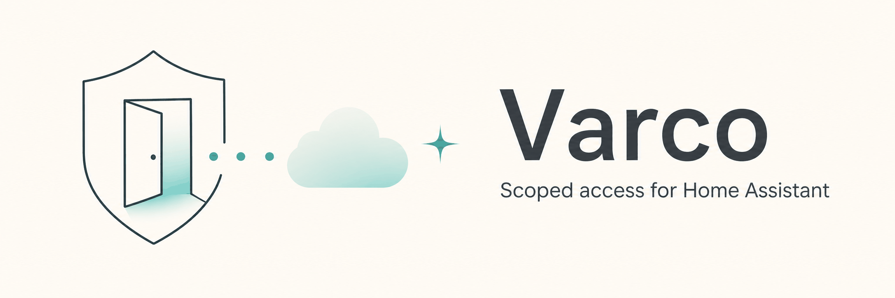

# Varco JIT

Varco JIT is an experimental fork of [Varco](https://github.com/vekexasia/varco). It lets external apps use Home Assistant without receiving a Home Assistant token and without requiring Home Assistant to be publicly reachable — and adds **JIT (just-in-time) state conditions**: grant restrictions that allow an operation only when other entities are in a required state at the moment the operation is attempted, with a structured denial cause returned to the consumer. See [JIT.md](JIT.md).

A consumer asks for a narrow grant. The Home Assistant owner approves or rejects it in the Varco JIT panel. Home Assistant then enforces that stored grant on every read, subscription, history query, camera snapshot, and service call.

## Video overview

[](https://www.youtube.com/watch?v=QSR6oZzUb4Y)

I made this short video explaining what Varco is and how it works.

## Start

> **Deploy in 10 minutes:** [vekexasia.github.io/varco/getting-started/quickstart](https://vekexasia.github.io/varco/getting-started/quickstart/)

- Home Assistant integration: copy `custom_components/varco_jit`. It installs as domain `varco_jit` (panel at `/varco-jit`) **alongside** the stock `varco` integration, with its own storage, so both can run at once for experiments.
- Browser client: `npm install @varco/client`.
- Bridge: use the default public bridge (`wss://varco-bridge.andreabaccega.com`) unless you need to self-host on Cloudflare or with the Node in-memory bridge.
- After every Varco update, restart Home Assistant and hard-refresh `/varco-jit` so the Python integration and panel bundle are reloaded.

Documentation: [vekexasia.github.io/varco](https://vekexasia.github.io/varco/). Source lives in [`docs/website`](docs/website).

## JIT state conditions

A grant restriction of type `jit` (alias `state_condition`) carries structured conditions over entity states — for example, allow `vacuum.start@vacuum.robot` only while `device_tracker.phone` is not `home`. Conditions are evaluated by the Authority just-in-time, immediately before the operation. A denial returns error code `jit_denied` with a machine-readable per-condition cause, is audited as `jit_denied` without logging actual state values, and does not consume rate-limit budget. Varco JIT uses the same bridge, wire protocol, and `@varco/client` as Varco; only the Home Assistant integration domain differs. Full spec: [JIT.md](JIT.md).

## Core guarantees

- Consumers never receive a Home Assistant long-lived access token.
- Home Assistant does not need an inbound public URL for Varco traffic.
- Grants are bound to a consumer public key and stored inside Home Assistant.
- Home Assistant remains the Authority for consent, grants, policy checks, service calls, and audit.
- The bridge routes encrypted envelopes and does not make permission decisions.
- Revocation is enforced by the Authority for active and future sessions.

## Try the demo

Open the Gazzetta-style energy dashboard: [varco-demo.andreabaccega.com](https://varco-demo.andreabaccega.com/).
Open the guest-stay dashboard: [varco-guest-demo.andreabaccega.com](https://varco-guest-demo.andreabaccega.com/).

These demos are browser-only consumers backed by a synthetic Home Assistant showcase instance. They connect through Varco with pre-approved grants scoped to the entities and actions used by each dashboard.


## Development

```bash
npm install
npm test
npm run build
npm run check
pytest -q tests
```

Package-level commands:

```bash
npm --workspace packages/client run test
npm --workspace bridge run test
npm --workspace examples/consumer-dashboard run build
npm run dev:ha:gazzetta-demo
npm run dev:ha:guest-stay-demo
```

Varco is an early MVP/prototype. The core pieces in this repository are implemented and covered by tests, but the API and grant model may still change.
